<div align="center">




### ✨ whoami

</div>

```java
public class Hirsya {
    String     name     = "Malikal Hirsya Alfatory";
    String     vibe     = "AI workflow & automation enthusiast 🤖";
    String     school   = "Computer Science @ University of Mataram";
    List<String> stack  = List.of("Java", "Python", "C++", "PHP", "MySQL");
    List<String> learning = List.of("Docker", "Lua", "Roblox Studio", "Vercel");
    String     motto    = "if the workflow can be automated, why do it manually?";
}
```

<div align="center">


### 🛠️ stack

<table>
  <tr>
    <td align="center"><b>Languages</b></td>
    <td></td>
  </tr>
  <tr>
    <td align="center"><b>Tools</b></td>
    <td></td>
  </tr>
  <tr>
    <td align="center"><b>Learning</b></td>
    <td></td>
  </tr>
  <tr>
    <td align="center"><b>OS</b></td>
    <td></td>
  </tr>
</table>


### 🔗 connect

<a href="https://discordapp.com/users/712661206783230043" target="_blank"></a>
<a href="mailto:malikalhirsya57@gmail.com"></a>
<a href="https://instagram.com/hirsya.a" target="_blank"></a>


### 📊 stats

<br>


</div>
